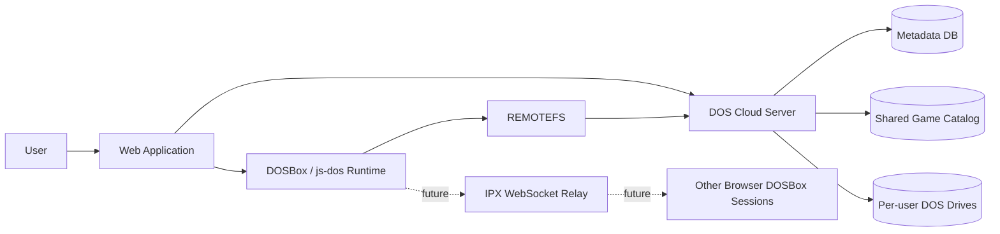
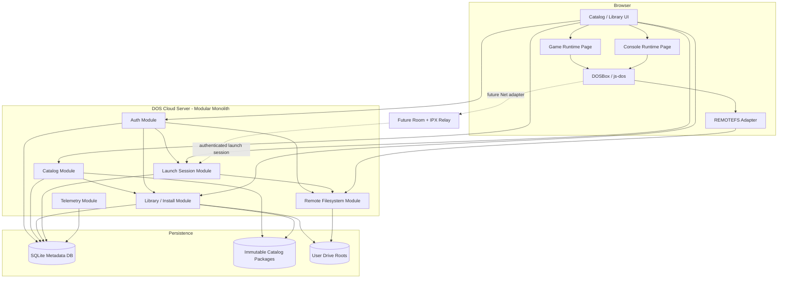
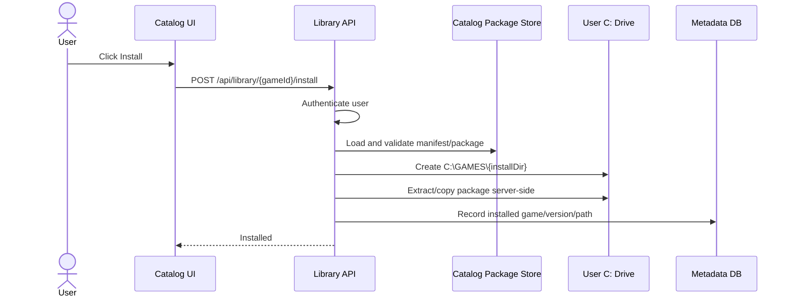
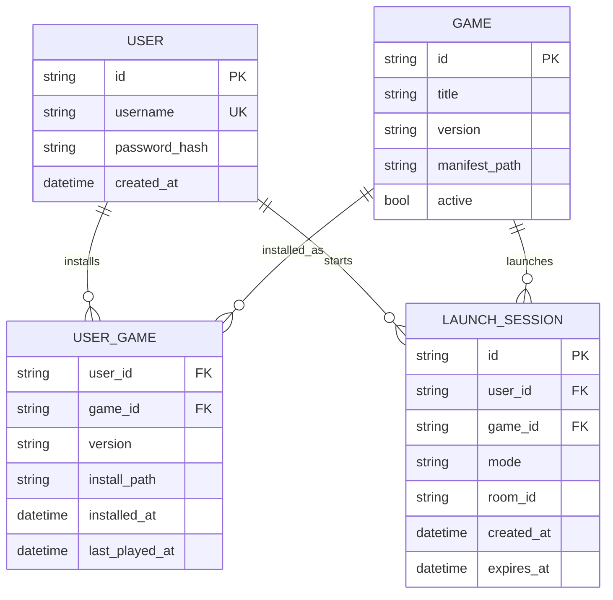
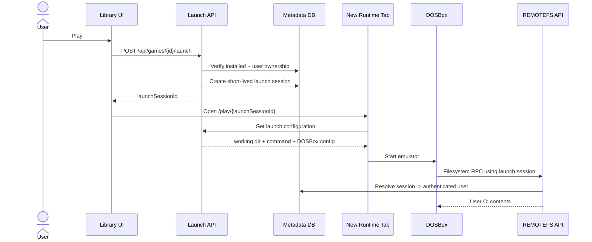
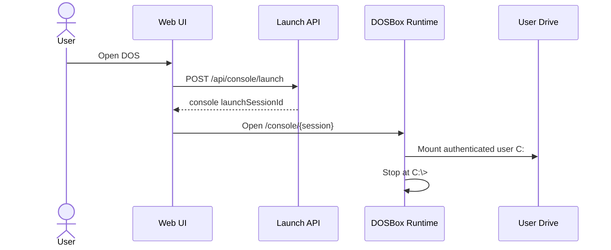
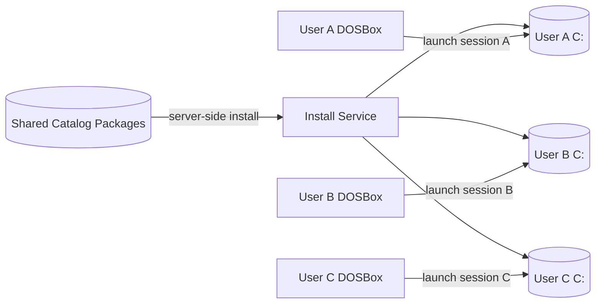
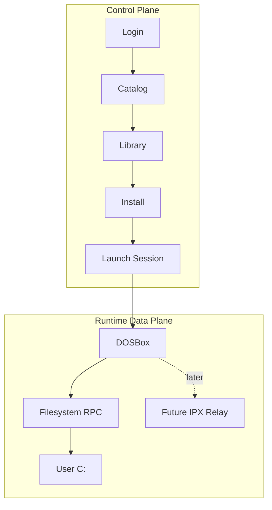
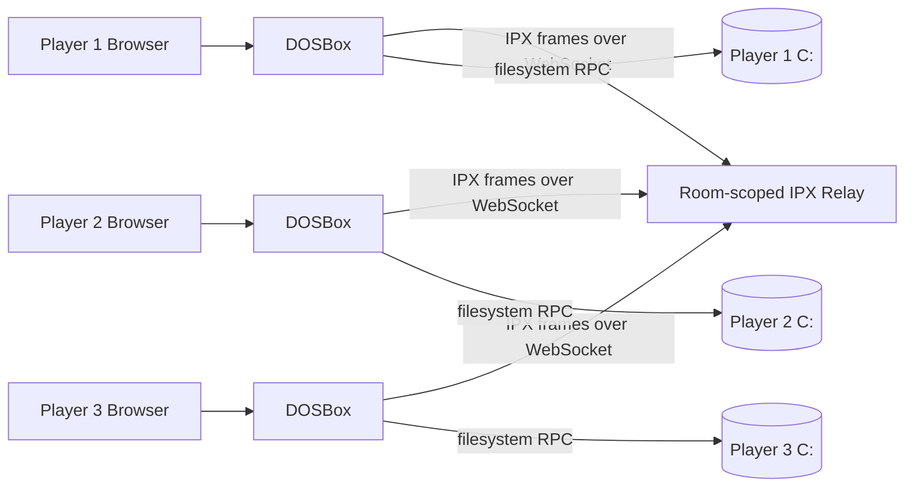

# Phase 2 Architecture

Status: architecture drafted for review  
Scope: multi-user DOS game platform, single-player first, multiplayer-ready

## 1. Architecture Goal

Evolve the Phase 1 Commander Keen filesystem prototype into a small browser-based DOS gaming platform.

The platform should feel closer to a lightweight "Steam for DOS" than a single embedded emulator:

- users sign in
- users browse a shared catalog of curated DOS games
- catalog entries have artwork, descriptions, metadata, and launch configuration
- users install games into their own DOS space
- installed games can be launched directly from the catalog/library
- a user can open a plain DOS console against the same personal C: drive
- save games, high scores, configuration files, and other writes persist in that user's space
- the platform is designed so IPX multiplayer can be added later without redesigning the filesystem or catalog

The initial product is still intentionally small. It is not trying to reproduce Steam account, commerce, workshop, achievements, or social features.

## 2. Key Architecture Decisions

1. **Use a modular monolith for the server.** Authentication, catalog, library/install, launch sessions, and remote filesystem functions are separate modules inside one deployable Node application.

2. **The game catalog is shared and immutable to normal users.** Catalog packages are curated server-side content. Users can install them but cannot modify the shared source package.

3. **Each user has a fully isolated authoritative DOS C: drive.** The server determines the storage root from the authenticated user/session. The browser never chooses another user's drive by path or ID.

4. **Installing a game copies/extracts the package into the user's drive.** The first implementation intentionally accepts duplicate storage. This gives old DOS games normal writable directories and allows saves, score files, INI/config files, and game-specific state to behave exactly as they expect.

5. **Launch behavior is metadata-driven.** The browser does not hard-code Commander Keen. A catalog manifest supplies working directory, executable, arguments, DOSBox settings, capabilities, and presentation metadata.

6. **Game launch and DOS-console launch use the same runtime and filesystem.** The difference is only the generated launch configuration. Game mode executes a configured command; console mode stops at the DOS prompt.

7. **The remote filesystem is a data-plane capability attached to a short-lived launch session.** The existing Phase 1 REMOTEFS behavior is retained, but drive=demo is replaced by authenticated session-to-user-drive resolution.

8. **Future IPX multiplayer is a separate network data plane.** The catalog can declare that a game supports IPX. A later room/relay capability can inject networking into the runtime without changing game installation or user filesystem semantics.

## 3. System Context



The browser application has two distinct experiences:

- the **control plane UI**, where the user browses, installs, launches, and manages games
- the **DOS runtime**, where DOSBox runs a game or a command prompt

The server owns both metadata and filesystem authorization.

## 4. Logical Components



### 4.1 Web Application

Responsibilities:

- login/logout
- browse catalog
- render Netflix-style rows/cards
- show install state
- install/uninstall games
- launch an installed game
- open a DOS console
- show recently played and installed titles
- open the DOS runtime in a new browser tab
- eventually create/join multiplayer rooms

The catalog UI is data-driven. Adding a new game should not require application code.

### 4.2 Authentication Module

Initial implementation:

- local user accounts
- modern password hashing
- server-side or signed application session
- HTTP-only session cookie

Architecturally, authentication sits behind a small adapter so OIDC can replace local authentication later.

The filesystem service must never accept userId, home path, or storage root from the browser.

### 4.3 Catalog Module

The catalog owns the definition of games available to the platform.

A catalog entry contains metadata equivalent to:

```json
{
  "id": "keen1",
  "title": "Commander Keen 1",
  "subtitle": "Marooned on Mars",
  "publisher": "Apogee / id Software",
  "genre": ["Platformer"],
  "version": "1.31-shareware",
  "coverAsset": "/catalog/keen1/cover.png",
  "package": {
    "path": "packages/keen1-1.31.zip",
    "sha256": "..."
  },
  "install": {
    "directory": "C:\\GAMES\\KEEN1"
  },
  "launch": {
    "workingDirectory": "C:\\GAMES\\KEEN1",
    "command": "KEEN1.EXE",
    "arguments": []
  },
  "dosbox": {
    "machine": "svga_s3",
    "memoryMb": 16,
    "cycles": 12000
  },
  "capabilities": {
    "singlePlayer": true,
    "ipx": false
  },
  "distribution": {
    "status": "verified-shareware",
    "sourceUrl": "...",
    "notes": "..."
  }
}
```

The schema intentionally contains distribution metadata. A title should only be published after its redistribution terms and source have been verified.

Candidate catalog content can include shareware editions of titles such as Commander Keen, DOOM, Wolfenstein 3D, Duke Nukem 3D, and other Apogee-era games. Other titles, including Prince of Persia, should only be included after confirming that the specific package being used is legally redistributable.

### 4.4 Catalog Package Store

Catalog packages are immutable source artifacts.

```text
catalog/
├── keen1/
│   ├── manifest.json
│   ├── cover.png
│   ├── screenshots/
│   └── keen1-1.31.zip
├── doom-shareware/
│   ├── manifest.json
│   ├── cover.png
│   └── doom-shareware.zip
└── wolf3d-shareware/
    └── ...
```

The package store is not mounted directly as the user's C: drive.

That separation is deliberate:

- catalog content is shared and controlled
- user content is private and writable
- installing a game creates a user-owned copy
- catalog upgrades do not silently overwrite user save state

### 4.5 Library / Install Module

The user's library records which catalog games are installed.



The package moves **server-to-server**. The browser does not download a ZIP and re-upload it through REMOTEFS.

For the first implementation:

- install is idempotent if the same version is already installed
- install never overwrites an existing user directory without an explicit future repair/reset action
- package extraction rejects path traversal / zip-slip
- package and extracted-size limits are enforced

### 4.6 User Drive

Each user receives a private DOS drive root.

```text
user-data/
└── users/
    └── {user-id}/
        └── C/
            ├── GAMES/
            │   ├── KEEN1/
            │   ├── DOOM/
            │   └── WOLF3D/
            ├── DOCS/
            └── USER/
```

The DOS game sees only:

```text
C:\
├── GAMES
├── DOCS
└── USER
```

A user's game directory is deliberately writable. Many DOS games keep saves, high scores, configuration, and runtime state beside the executable. Copying the game into the user's C: drive lets those behaviors work without game-specific save adapters.

The Phase 1 case-insensitive path behavior remains required because the host filesystem is Linux while DOS filenames are case-insensitive.

### 4.7 Metadata Database

SQLite is sufficient for the first implementation and keeps the system self-contained.



The manifest remains the authoritative detailed definition of how a game installs and launches. The database holds searchable/indexable catalog metadata plus user state.

### 4.8 Launch Session Module

Launching creates a short-lived server-side capability rather than allowing the browser to invent filesystem context.



A launch session contains:

- user ID
- mode: game or console
- game ID when applicable
- game/version metadata
- optional future multiplayer room ID
- expiration time

The browser can possess the launch-session identifier, but it cannot use it to select another user's filesystem.

### 4.9 Game Runtime

The current Phase 1 hard-coded configuration:

```text
mount c /remote
c:
cd \KEEN
KEEN1.EXE
```

becomes generated from catalog metadata.

Example:

```text
mount c /remote
c:
cd \GAMES\KEEN1
KEEN1.EXE
```

The runtime page itself is generic.

Responsibilities:

- fetch launch configuration
- start js-dos
- mount REMOTEFS as C:
- generate AUTOEXEC commands
- display game-specific controls/instructions if provided by metadata
- expose full-screen and audio controls
- terminate/expire the launch session cleanly

### 4.10 DOS Console Mode

Console mode uses the same user C: drive and the same REMOTEFS.



AUTOEXEC is effectively:

```text
mount c /remote
c:
cd \
```

The user can then run normal DOSBox-supported commands such as DIR, CD, and installed game executables.

## 5. Netflix-Style Catalog Experience

The UI should be driven by catalog queries, not hard-coded rows.

Initial rows:

- Continue Playing / Recently Played
- Installed Games
- Featured
- Platformers
- Shooters
- Shareware Classics

Each card can show:

- cover art
- title
- short subtitle
- installed/not installed state
- Install button
- Play button when installed
- optional details action

The first implementation does not need recommendations, ratings, or personalization beyond installed/recently played.

## 6. Storage and Isolation



Rules:

- users never share writable drive roots
- catalog packages are not writable by runtime sessions
- user drive paths are resolved only on the server
- launch session and authenticated user must match
- no public API accepts an arbitrary host filesystem path
- no client-supplied userId is trusted for filesystem routing

## 7. Control Plane vs Data Plane



The filesystem is persistent state. IPX packets are ephemeral network traffic. They share identity/session context but not implementation.

## 8. Future Multiplayer Architecture

Multiplayer is designed in but not implemented in the immediate build.

A catalog entry can later declare IPX capability and maximum player count. A room service can create an authenticated room and attach the room ID to each launch session.



Important separation:

- each player keeps an independent C: drive
- IPX relay shares packets, not files
- the platform does not implement game logic
- DOS games continue to believe they are communicating on an IPX LAN
- the relay routes only between authenticated members of the same room

## 9. Security Boundaries

### Authentication

- all library/install/launch APIs require an authenticated user
- passwords are never stored in clear text
- filesystem RPC is scoped by authenticated launch session
- launch sessions expire

### Filesystem isolation

- derive user root server-side
- retain traversal protection
- retain DOS case-folding behavior
- do not expose physical filesystem paths
- do not allow one session to attach to another user's open file handles

### Catalog ingestion

- catalog content is administrator-controlled
- verify distribution rights before publishing a title
- record source URL and distribution notes
- record package checksum
- reject archive path traversal
- cap package and extracted sizes

### Browser/API

- same-origin application by default
- tighten prototype wildcard CORS for authenticated endpoints
- HTTP-only authentication cookie
- CSRF protection for mutating control-plane operations if cookie auth is used
- launch sessions are unguessable and short-lived

## 10. What Carries Forward from Phase 1

Keep:

- js-dos 8.4.1 runtime
- custom Emscripten REMOTEFS concept
- synchronous HTTP RPC from DOSBox worker
- server-authoritative file operations
- case-insensitive DOS path resolution
- open/read/write/seek/close semantics
- directory operations
- path traversal protection
- plain-LAN HTTP compatibility for development
- visible filesystem telemetry as a useful demo feature

Refactor or replace:

| Phase 1 prototype | Phase 2 target |
| --- | --- |
| Hard-coded Commander Keen | Metadata-driven catalog |
| drive=demo | Session-derived user drive |
| One shared drive | Per-user isolated C: |
| No login | Authenticated users |
| Hard-coded AUTOEXEC | Generated launch configuration |
| Static game data under demo drive | Immutable catalog packages + user installs |
| Filesystem session only | Application launch session |
| Wildcard CORS | Deliberate authenticated API policy |
| One large server file | Modular server components |
| UI proves filesystem | Catalog/library product UI |

## 11. Deployment Shape for the Next Implementation

The next implementation should remain simple:

```text
Node Application
├── static web UI
├── auth module
├── catalog module
├── library/install module
├── launch-session module
├── remote filesystem module
└── telemetry

SQLite
catalog/packages/
user-data/users/
```

No microservice split is required to implement the next phase.
